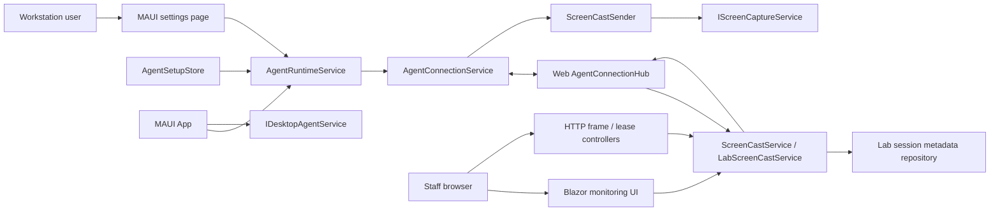

# Agent architecture and branch migration reference

Reference branch: `feat/screen-casting`  
Reference commit: `2ff23923065cfc6b6bd68ae1114fda08c8dd4ca4`  
Inspected: 2026-11-15

This document describes the source in this branch so another branch can reproduce its agent architecture. It records source-level behavior; native builds and deployment were not verified while preparing this document. Paths are relative to the repository root unless linked otherwise.

## Architectural shape

`CLMS.Agent` is a .NET 10 MAUI desktop application installed on each monitored workstation, running in the signed-in OS user's session. It maintains an outbound authenticated SignalR connection to `CLMS.Web`. It captures the desktop only after an authorized web viewer requests a session. The settings window can be hidden while the connection continues running.

The central ownership rule is: **the application runtime owns the connection; the settings page only controls and observes it**. Screen sharing has a shorter lifetime than the connection. Ending capture leaves the agent connected and available for another request.

Windows and Mac Catalyst use the same runtime, transport, protocol, setup flow, and sending loop. Native screen capture and desktop integration are behind `IScreenCaptureService` and `IDesktopAgentService`.



These actors are users, processes, and collaborating services; this project does not implement an actor framework.

## Actors and source locations

| Actor / component | Location | Responsibility |
| --- | --- | --- |
| Workstation user | Native settings window and tray/menu bar | Saves setup, enables login startup, pauses/reconnects, stops sharing, hides settings, or quits. |
| Authorized staff viewer | `CLMS.Web/Components/Pages/Monitoring/` | Requests live views and lab sessions through the browser. Services and frame endpoints accept Admin/Faculty; `AllScreens.razor` itself requires Admin. |
| Agent composition root | [`CLMS.Agent/MauiProgram.cs`](../CLMS.Agent/MauiProgram.cs) | Registers shared services and selects native implementations at compile time. |
| Application/lifetime owner | [`CLMS.Agent/App.xaml.cs`](../CLMS.Agent/App.xaml.cs) | Creates the settings window, initializes desktop integration, starts the runtime, updates the native indicator, and coordinates quit. |
| Settings UI | `CLMS.Agent/Views/MainPage.xaml` and `.xaml.cs` | Saves setup and invokes runtime/desktop controls. Subscribes to status while visible; never owns background work. `ViewModels/` currently has no view-model implementation. |
| Runtime supervisor | [`CLMS.Agent/Services/AgentRuntimeService.cs`](../CLMS.Agent/Services/AgentRuntimeService.cs) | Loads saved setup, owns retry/cancellation, restarts with new credentials, and disconnects on pause/quit. |
| Connection transport | [`CLMS.Agent/Services/AgentConnectionService.cs`](../CLMS.Agent/Services/AgentConnectionService.cs) | Validates configuration, owns `HubConnection`, registers capture commands, sends heartbeats, and stops sharing on connection loss. |
| Setup persistence | `CLMS.Agent/Services/AgentSetupStore.cs` | Stores the address in MAUI Preferences and the raw device credential in SecureStorage. |
| Capture sender | [`CLMS.Agent/Services/ScreenCastSender.cs`](../CLMS.Agent/Services/ScreenCastSender.cs) | Owns one cancellable capture/send loop, frame size checks, capture status, and native cleanup. |
| Native desktop adapter | `CLMS.Agent/Platforms/Windows/WindowsDesktopAgentService.cs`; `Platforms/MacCatalyst/MacDesktopAgentService.cs` | Settings visibility, background indicator/actions, and per-user login startup. |
| Native capture adapter | `CLMS.Agent/Platforms/Windows/WindowsScreenCaptureService.cs`; `Platforms/MacCatalyst/MacScreenCaptureService.cs` | Captures one display and returns the common in-memory JPEG contract. |
| Agent-facing server hub | [`CLMS.Web/Hubs/AgentConnectionHub.cs`](../CLMS.Web/Hubs/AgentConnectionHub.cs) | Authenticated presence, heartbeat replies, frame publishing, and capture-stop acknowledgements. |
| Device authentication | `CLMS.Web/Services/AgentConnections/` | Maps provisioned key hashes to computer-unit IDs and tracks live presence. |
| Temporary live-session owner | `CLMS.Web/Services/ScreenCasting/ScreenCastService.cs` | Owns connected-unit mapping, viewer ownership, leases, latest frames, and start/stop commands. |
| Lab-session coordinator | `CLMS.Web/Services/ScreenCasting/LabScreenCastService.cs` | Adds lab membership, persistent session history, and coordinated per-PC previews. |
| Browser frame delivery | `CLMS.Web/Controllers/ScreenCastFramesController.cs`; `LabScreenCastController.cs` | Cookie-authenticated JPEG retrieval and lab lease renewal. |
| History persistence | `CLMS.Application/Persistence/Interfaces/IScreenCastRepository.cs`; `CLMS.Infrastructure/Persistence/MySql/Repositories/ScreenCastRepository.cs` | Persists session and connection metadata, not frame bytes. |
| Shared wire contract | [`CLMS.Shared/Dtos/AgentConnectionInfo.cs`](../CLMS.Shared/Dtos/AgentConnectionInfo.cs); [`ScreenCastMessages.cs`](../CLMS.Shared/Dtos/ScreenCastMessages.cs) | Protocol names, messages, routes, and limits used by both processes. |

## Project and dependency boundaries

- `CLMS.Agent/CLMS.Agent.csproj` references `CLMS.Shared`, MAUI Controls, Debug logging, and SignalR Client. It does not reference Application, Domain, Infrastructure, or Web, and does not connect directly to MySQL.
- The target is `net10.0-windows10.0.22621.0` on Windows and `net10.0-maccatalyst` on macOS. `UseMaui`, `SingleProject`, and XAML `SourceGen` are enabled. Windows uses an unpackaged executable (`WindowsPackageType=None`).
- Windows declares minimum OS 10.0.17763.0, but capture explicitly requires Windows 10 version 2004 / build 19041 or later. Mac Catalyst declares minimum 18.2 (macOS 15.2), matching the capture API used here.
- `Models/ScreenFrame.cs` is the native-to-shared-loop result: JPEG bytes, width, height, and capture timestamp. `Models/AgentConnectionSnapshot.cs` is observable connection state: status, optional unit ID, and last acknowledgement time. The capture timestamp is not part of the frame wire DTO.
- `Services/IAgentSetupStore.cs` exposes only address/key reads to the supervisor. `IAgentConnectionTransport.cs` exposes connection state and connect/disconnect so the runtime can be tested with fakes.

### Dependency injection lifetimes

In `MauiProgram.CreateMauiApp`, all of these are singletons: platform `IScreenCaptureService`, platform `IDesktopAgentService`, `AgentConnectionService`, `ScreenCastSender`, `AgentSetupStore`, and `AgentRuntimeService`. `IAgentSetupStore` and `IAgentConnectionTransport` resolve to the same already-registered concrete singleton instances. `MainPage` is transient and is injected into `App`.

Preserve those aliases: independently registering another transport or setup instance would split state. Native services are selected with `#if WINDOWS` / `#elif MACCATALYST`; unsupported targets produce a compile-time error.

### The linked generated App file

The referenced `App.xaml.xsg.cs` in Rider's temporary `SourceGeneratedDocuments` directory is generated from `CLMS.Agent/App.xaml`. Its `InitializeComponent` builds the application resources, merging `Resources/Styles/Colors.xaml` and `Styles.xaml`, with a Hot Reload runtime-inflation fallback.

The authored architectural entry points are `MauiProgram.cs` and `App.xaml.cs`. Edit the authored XAML/C# and regenerate; do not copy or edit the temporary generated file. `AppShell.xaml` exists, but the active `App.CreateWindow` directly uses `MainPage`, not `AppShell`.

## Startup, settings, and shutdown

1. Native startup calls `MauiProgram.CreateMauiApp`. Windows enters through `Platforms/Windows/App.xaml.cs`; Mac uses `Platforms/MacCatalyst/Program.cs` and `AppDelegate.cs`.
2. `App.CreateWindow` creates a 660 x 800 settings window. On `Created`, it initializes the desktop adapter, subscribes to status events, and calls `runtime.StartAsync()`.
3. The runtime serializes Start/Stop using a semaphore. Starting first stops prior work, then reads the saved server address and secure device key. Missing or unreadable credentials return `false` and leave setup accessible.
4. With a saved key, it starts its background loop and returns `true`. This means configured, not necessarily successfully connected. `agent.start-hidden` defaults to `true`, so a configured agent may hide while its initial connection is still pending.
5. Failed initial connections retry every 15 seconds; each attempt has a 20-second timeout. Connected transports perform their own SignalR reconnect first. The supervisor starts a new transport connection when the old one reaches Disconnected.
6. Saving setup persists it and restarts the runtime. Reconnect reloads saved values; editing fields without saving does not change the connection. Pause cancels background work and disconnects, leaving the application open.
7. Hiding/disappearing settings removes UI subscriptions only. Native and application status observers continue. UI and desktop updates are dispatched to the MAUI main thread.
8. Quit uses a guard against repeated shutdown, stops the runtime (and thus capture/transport), removes application subscriptions, disposes desktop integration, then calls `Quit`. Window destruction also invokes this path.

The native indicator prioritizes active sharing, then transport status, then runtime status. If native initialization/startup throws, the application logs the error and attempts to show settings.

## Setup and identity

| Setting | Storage / owner | Meaning |
| --- | --- | --- |
| `agent.server-address` | MAUI Preferences | HTTPS server base address; default `https://localhost:7190` in `Configuration/ServerOptions.cs`. Other PCs require a reachable server address and trusted certificate. |
| `agent.device-key` | MAUI SecureStorage | Per-unit credential, 32–512 characters after trimming. Never stored as an ordinary preference. |
| `agent.start-hidden` | MAUI Preferences | Hide settings after configured startup; defaults to true. |
| Login startup | Native OS registration | Independent of the start-hidden preference; applies to this OS user. |
| `AgentConnections:Devices` | Web server configuration | Provisioned entries with `ComputerUnitId` and a 64-character hex `KeySha256`. This branch uses manual provisioning. |

Both setup and transport enforce an absolute HTTPS address without embedded credentials, query, or fragment. The transport supplies the raw key as a bearer token via SignalR's `AccessTokenProvider`; it keeps credentials in memory only.

`AgentKeyAuthenticationHandler` requires HTTPS, hashes the supplied credential with SHA-256, compares hashes in constant time, rejects ambiguous reused keys, and creates a unit identity claim. The unit ID comes from that server claim, never from a client-selected identity. Authentication expires after 15 minutes; hub mapping enables `CloseOnAuthenticationExpiration` so reconnection reauthenticates rotated/removed credentials. Browser cookie/staff authentication remains a separate scheme.

## Connection and capture protocol

| Direction | Name / route | Contract |
| --- | --- | --- |
| Agent to Web | `/hubs/agents` | SignalR endpoint authenticated with `AgentKey`. |
| Agent to Web | `Heartbeat` | No unit argument; returns `AgentConnectionInfo(ComputerUnitId, ConnectionId, ServerTimeUtc)`. Sent immediately after connect/reconnect and every 15 seconds while connected. |
| Web to Agent | `StartScreenCast` | `ScreenCastCommand(SessionId)` invokes sender start with the connection's lifetime token. |
| Web to Agent | `StopScreenCast` | `ScreenCastCommand(SessionId)` stops only a matching active capture. |
| Agent to Web | `PublishScreenFrame` | `ScreenCastFrame(SessionId, JpegBytes, Width, Height)`; returns a Boolean. False ends the sender loop. |
| Agent to Web | `ScreenCaptureStopped` | Sends the active session GUID when the loop finishes, if the hub is connected; acknowledgement has a three-second timeout. |
| Browser to Web | `GET /api/screen-cast/{sessionId}/frame?after={sequence}` | Returns a newer JPEG with `X-Frame-Sequence`, 204 when no newer frame exists, or 404 for an unavailable/unowned/expired session. An accepted request renews the viewer lease. |
| Browser to Web | `GET /api/screen-cast/labs/{id}/lease` | Renews the owned lab lease; returns 204 or 404. |

SignalR reconnect delays are 0, 2, 10, and 30 seconds. On Reconnecting or Closed, transport stops capture. Reconnection acknowledges presence but does not resume the old capture session. Disconnect cancels the connection lifetime, awaits sender stop, disposes the hub, and awaits heartbeat completion.

`ScreenCastSender` serializes start/stop. A new start stops and awaits the old loop before replacing it. The loop captures immediately and then uses a 500 ms timer, awaiting each publish for backpressure. It checks cancellation after capture and rejects JPEGs larger than 512 KiB. Its `finally` always calls native `StopAsync`, clears sharing state, and attempts the server acknowledgement. Permission/capture failures become status messages and logs.

## Native adapters

| Concern | Windows | Mac Catalyst |
| --- | --- | --- |
| Capture | Windows Graphics Capture with Direct3D11 interop in `WindowsGraphicsCaptureInterop.cs`; persistent native session per viewing run. | ScreenCaptureKit with `SCShareableContent`, `SCContentFilter`, and `SCScreenshotManager`; fresh screenshot/content enumeration per capture. |
| Display | Primary monitor; rebuilds for primary-monitor or resolution changes; closed display becomes an error. | Display whose origin is (0,0), falling back to the first available display. |
| JPEG | Aspect ratio preserved, width capped at 1280, no upscaling, quality 0.7, cursor disabled. Cached JPEG can serve a static desktop without a new native frame. | Same width/quality/cursor behavior; audio disabled. Native screenshot completion is awaited before disposal even if cancellation arrives midway. |
| Native lifetime | Latest native frame replaces/disposes the previous frame; stop releases session, frame pool, outstanding frame, device, and cached image. First-frame wait times out after five seconds. | Native objects are disposed per capture; uses the interface's default no-op `StopAsync`. |
| Permission | Requests borderless access where supported; denial falls back to normal capture borders. OS capture denial is surfaced as an authorization error. | Screen recording permission is requested through the native API; denial tells the user to allow the app in System Settings and restart it. |
| Background UI | Win32 notification icon and context menu. Closing settings is canceled and hides it. Tray recreation handles Explorer restart. Hiding requires a created icon. | AppKit `NSStatusBar`/menu through Objective-C interop. Explicit Hide/Show; removes Close menu and disables native close buttons to preserve the scene. |
| Login startup | `HKCU\Software\Microsoft\Windows\CurrentVersion\Run`, value `CLMS.Agent`, quoted executable path. Re-enable after moving the executable. | `SMAppService.MainApp` registration; signed app installed in Applications and OS approval may be required. |
| Instance/scene behavior | Per-user named mutex; a second launch broadcasts `CLMS.Agent.ShowSettings` then exits. | Single-scene configuration in `Info.plist` with `SceneDelegate`; no matching explicit Windows-style mutex in this adapter. |

Both desktop adapters expose Open settings, Stop screen sharing, and Quit. Mac also exposes Hide settings and keeps an `NSProcessInfo` background activity that allows system sleep. Preserve Mac `Info.plist`, `Entitlements.plist` (sandbox plus outbound network client), app delegate/menu configuration, and scene delegate when porting. Preserve Windows manifests and interop helpers with their adapter.

This is a per-user desktop background application, not an installed Windows service or a pre-login capture daemon. Login startup and Windows boot are different lifecycle events.

## Server session ownership and browser behavior

`AddAgentConnections` registers the authentication scheme, SignalR hub limits, singleton `TimeProvider`, singleton `AgentPresenceStore`, and singleton/hosted `ScreenCastService`. `CLMS.Web/Program.cs` separately registers `LabScreenCastService` as both singleton and hosted service, maps controllers and the hub, enables authentication/authorization, sets the hub buffer limit, and disables antiforgery for the device hub. Hub and frame routes are excluded from HTML status-page re-execution so clients receive protocol status codes.

`ScreenCastService` is single-server in-memory state:

- A unit maps to its current connection ID. Replacing the connection invalidates old captures. Old disconnects/heartbeats cannot overwrite the replacement's presence.
- Each temporary session belongs to one staff identity, unit, and connection. Only the owner may fetch frames or stop it. Only the currently authenticated unit/connection may publish into it.
- One capture per unit and at most 16 captures per viewer are permitted. A 15-second viewer lease is renewed by real browser frame requests, including requests with no newer frame. A one-second sweep expires sessions and sends stop commands.
- Only the newest bounded JPEG and its sequence are retained. The server validates JPEG markers and embedded dimensions against the supplied metadata: width 1–1280, height 1–4096, payload at most 512 KiB. Accepted updates are spaced at least 450 ms apart. Hub message/buffer limit is 768 KiB to allow JSON/base64 overhead.
- Agent disconnect or capture-stop acknowledgement removes the temporary session. Reconnect requires a new viewing request. No screenshot/video recording is persisted.

`UnitScreenView.razor` and `.razor.js` implement individual preview controls and browser JPEG polling (500 ms). Details wait for **Start viewing**. The lab wall starts only after **Start session**, captures the current page of up to 16 previews, stops previews when paging away, and offers retry for stopped/failed previews. Enlarging a preview reuses its existing stream. Hidden/closed pages stop browser polling and attempt cleanup; lease expiry is the fallback if cleanup cannot reach the server. A Blazor circuit timer must not keep an absent browser's capture alive.

`LabScreenCastService` adds a separate integer database session ID over temporary GUID capture IDs. It snapshots registered lab units, enforces one active lab session per lab on this process, checks owner and membership, and rechecks current membership before starting a preview. Browser JavaScript renews the lab lease every five seconds, even with no online PCs. Session expiry marks history failed; explicit End marks ended. A one-second sweep reconciles capture disconnections and retries pending history writes. Closing stops captures before attempting database writes. On the first new lab session after restart, persisted interrupted sessions are recovered as failed. Existing `screen_cast_sessions` and `screen_cast_connections` store metadata, not image data. See [`Database/SCREEN-CASTING.md`](../Database/SCREEN-CASTING.md).

`AgentPresenceStore` supplies authenticated, process-local presence. `CLMS.Web/Models/UnitMonitoringPresence.cs` overlays its connection/heartbeat/IP data on existing inventory/session DTOs. Database status remains the fallback for units without agent presence; inventory and current-user/session data continue to come from existing repositories.

## Legacy material and limits of this snapshot

- `CLMS.Agent/README.md` describes an earlier Windows console access-log prototype. It is not an accurate description of this MAUI runtime.
- Root `CLMS.Agent/Program.cs`, `WindowsAccessMonitor.cs`, `UnitAccessEvent.cs`, and `AccessEventChecks.cs` remain from that prototype. They monitor startup/sign-in/unlock event logs and use a local checkpoint. They are not wired into `AgentRuntimeService`, the SignalR transport, or the MAUI settings lifecycle.
- The root `Program.cs` still contains top-level console startup, while native MAUI entry points also exist. This document does not establish how that coexistence builds/runs on each host. Resolve the intended entry point and legacy compile inclusion in the destination branch and verify native builds; do not mistake those leftovers for the desktop runtime design.
- `AppShell` and the empty `ViewModels/` directory are not active architectural layers. The settings UI uses code-behind.
- Live connection, presence, frame, and lease state belongs to one web-server process. A multi-server deployment requires an additional shared-state/routing design; database history alone does not provide it.
- Automated shared-service tests do not establish that native capture, tray/menu handling, signing, login registration, or permissions work on real hosts.

## Rewrite checklist for another branch

1. Compare the destination to the reference commit above. Preserve destination-specific features deliberately, and resolve its startup/legacy code before transplanting the MAUI project layout.
2. Recreate the MAUI project settings, host-specific entry points, XAML resources, platform manifests/plists, and `CLMS.Shared` reference. Generate XAML output from source instead of moving Rider temporary files.
3. Bring over the common `Services/`, `Models/`, and `Configuration/ServerOptions.cs`. Keep setup reads and transport behind their interfaces so runtime tests remain independent of MAUI.
4. Match `MauiProgram` singleton registrations and interface aliases. Install only the platform adapters for the host target. Keep protocol strings/DTOs/limits synchronized between Agent and Web.
5. Match `App` startup, status, hidden-window, and quit behavior. Wire `MainPage` to saved setup and the runtime. Ensure page disappearance never disconnects or disposes background services.
6. Bring over native capture and desktop adapters with all helper files. Preserve resource cleanup, cancellation ordering, per-user startup, settings recovery, and local Stop sharing controls.
7. Align the Web authentication setup, device provisioning, hub mapping, heartbeat/presence overlay, session services, frame/lease controllers, and browser polling. Preserve identity/ownership checks and lease expiry together.
8. If matching the full lab wall, also align monitoring Razor/JS/CSS, `ScreenWallLayout`, lab-session repository/domain mappings, existing table expectations, and service registrations. Agent-only changes cannot reproduce the complete workflow.
9. Reuse the existing tests below, build each native target on its host, then perform physical workstation/browser checks. Treat successful compilation, shared-service tests, and native deployment checks as separate evidence.

### Existing verification coverage

| Tests in `CLMS.Tests/` | Architectural behavior covered |
| --- | --- |
| `AgentRuntimeTests.cs` | Missing/unreadable setup, initial retries, closed connection restart, in-flight cancellation, credential reload, disconnect ordering, disposal. |
| `AgentConnectionTests.cs` | Device identity/auth failures, duplicate keys, frame transfer/validation, viewer ownership, unit/connection binding, lease expiry, no old-session resume, shared sender integration. |
| `ScreenCastSenderLifecycleTests.cs` | Cancellation waits for capture and releases native resources; failure also releases them. |
| `AgentPresenceTests.cs` and `UnitMonitoringStatusTests.cs` | Fresh/stale/disconnected presence, replacement connection protection, database fallback, availability rules. |
| `LabScreenCastTests.cs` | Lab scope/ownership, paging/end behavior, missing browser expiry, local stop/disconnect history, database-failure cleanup, moved-PC rejection. |
| `LabScreenCastLease.test.mjs`, `ScreenWallLayout.test.mjs`, `UnitScreenView.test.mjs` | Browser lease and screen-wall/preview behavior. |

The .NET test project links selected Agent service/model source files directly instead of loading the native MAUI app. Preserve these linked compile entries when moving files; the current linked set does not include the concrete native adapters or `AgentConnectionService`.

Run after implementing the rewrite (these commands were not run for this documentation-only change):

```powershell
dotnet test CLMS.Tests/CLMS.Tests.csproj --artifacts-path artifacts/agent-architecture-tests
node CLMS.Tests/LabScreenCastLease.test.mjs
node CLMS.Tests/ScreenWallLayout.test.mjs
node CLMS.Tests/UnitScreenView.test.mjs
dotnet build CLMS.Agent/CLMS.Agent.csproj
```

Run the Agent build on both Windows and macOS with the corresponding MAUI workloads. Use a separate artifacts directory for tests if a running LAN server holds output DLLs. On physical machines, check first-run setup, offline startup/retry, hidden settings recovery, duplicate Windows launch, pause/reconnect, authorized viewing, local stop, browser close/lease expiry, network interruption, display changes, OS permission denial, login startup, and quit. Verify the agent stays connected without capturing between viewing sessions.
