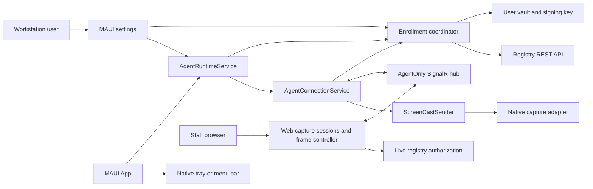

# Single-project desktop agent architecture

The integration combines `chore/architecture-rewrite` (registry, persistent device authentication, account security) with `feat/screen-casting` at `2ff23923065cfc6b6bd68ae1114fda08c8dd4ca4`. The original architecture reference is preserved in Git commit `3fc8e6f`.

## Deployment and ownership

**One workstation application: Labster (`CLMS.Agent`).** It is a .NET 10 MAUI desktop process for Windows or Mac Catalyst. There is no separate Core library, service, console host, local control socket, named-pipe server, or session companion. `CLMS.Shared` remains the common contract assembly (and currently references Domain); the web server and its application/infrastructure projects remain separate.

The signed-in OS user owns enrollment and protected keys. The application runtime owns authentication polling and the outbound SignalR connection. Settings merely controls and observes these services. Capture belongs to a shorter, viewer-authorized session. Hiding settings or stopping capture leaves the application alive; logout or Quit ends it. Pause stops authentication polling, transport, and capture.



## Actors and source map

| Actor/component | Source | Responsibility |
| --- | --- | --- |
| Workstation user | `CLMS.Agent/Views/MainPage.xaml` and `.xaml.cs` | Configure server, select a server-provided lab/unit, request enrollment, display approval code, reconnect/pause, rotate/reset, stop sharing, startup, Hide/Quit. |
| Composition root | [MauiProgram.cs](../CLMS.Agent/MauiProgram.cs) | Singleton services, same-instance interface aliases, and compile-time native adapter selection. MainPage is transient. |
| Application | [App.xaml.cs](../CLMS.Agent/App.xaml.cs) | Settings window, desktop initialization, runtime/monitoring startup, sharing indicator, and ordered shutdown. |
| Runtime | [AgentRuntimeService.cs](../CLMS.Agent/Services/AgentRuntimeService.cs) | One cancellable enrollment/connection loop, bounded attempts, retry, pause/restart, and connection teardown on recovery/storage failure. |
| Identity coordinator | [AgentCoordinator.cs](../CLMS.Agent/Services/Identity/AgentCoordinator.cs) | Enrollment completion, serialized challenge proof/JWT acquisition, REST heartbeat, durable key rotation/recovery, and local reset. |
| Identity adapters | `CLMS.Agent/Services/Identity/AgentApi.cs`, `AgentState.cs`, `IDeviceKeyStore.cs`, `UserAgentVault.cs` | HTTPS API, credential-free UI status, journaled protected state, and native signing abstraction. |
| Transport | `CLMS.Agent/Services/AgentConnectionService.cs`, `IAgentConnectionTransport.cs`, `IAgentAccessTokenProvider.cs` | SignalR, fresh JWT provider on reconnect, heartbeat, status, and capture commands. |
| Screen sender | `CLMS.Agent/Services/ScreenCastSender.cs`, `IScreenCaptureService.cs`, `Models/ScreenFrame.cs` | One capture/send loop with cancellation, backpressure, and native resource cleanup. |
| Windows adapters | `CLMS.Agent/Platforms/Windows/` | Current-user CNG signing keys, Win32 tray/login startup, and Graphics Capture/D3D11. |
| Mac adapters | `CLMS.Agent/Platforms/MacCatalyst/` | User login-Keychain keys, AppKit menu/login startup, ScreenCaptureKit screenshots, and the single MAUI scene. |
| Registry authority | `CLMS.Web/Controllers/AgentController.cs`, `CLMS.Application/UnitRegistry/`, `CLMS.Web/Authentication/AgentAuthentication.cs` | Registration approval, ECDSA proofs, dedicated agent JWTs, and current credential/generation validation. |
| Device hub | `CLMS.Web/Hubs/AgentConnectionHub.cs`, `Services/AgentConnections/` | AgentOnly authorization, per-call credential filter, authenticated presence, and unit-to-connection/credential mapping. |
| Viewer/session actors | `CLMS.Web/Services/ScreenCasting/`, `Controllers/ScreenCastFramesController.cs`, `LabScreenCastController.cs`, `Components/Pages/Monitoring/` | Staff ownership, browser leases, JPEG delivery, lab membership/history, and screen wall. |
| Shared protocol | `CLMS.Shared/Dtos/UnitRegistry.cs`, `ScreenCastMessages.cs`, `AgentConnectionInfo.cs`, `Security/DeviceProtocol.cs` | Enrollment/authentication contracts, exact signed proof payload, and capture messages/limits. |

Moved identity/native/monitoring types retain their historical `CLMS.Agent.Core` / `CLMS.Agent.Service` namespaces to preserve resolved references. These are namespaces inside the one Agent assembly, not additional projects or processes. Tests link portable Agent source directly and do not load the native MAUI host.

## Enrollment, protected storage, and authentication

Keep the registry protocol documented in [unit-registry.md](unit-registry.md): physical-code administrator approval, non-exportable P-256 signing keys, registration-secret completion proof, one-use challenges, journaled rotation, credential generations, and memory-only 15-minute JWTs. There are no agent refresh tokens or inactivity expiration. A device can authenticate after months offline with its retained active key. Human authentication, Google sign-in, 2FA, and account recovery stay separate.

- Windows: signing-only current-user CNG keys with private export disabled; metadata is atomically replaced DPAPI CurrentUser-protected data under `%LOCALAPPDATA%/CLMS/Agent`. The directory ACL grants the owning user access. Native keys are never serialized into the vault.
- Mac: native Security.framework keys in the user's default login Keychain, non-extractable and restricted to the signed application. The complete metadata snapshot is another protected Keychain item (`CLMS.Agent.Desktop.v1`). Keep a stable signing identity when upgrading. The enterprise MAUI application is unsandboxed for its native desktop integration.
- Metadata/key failures retain recovery state and never fall back to plaintext. Vault IO is deferred until runtime startup so settings can still open after a storage failure.
- The internal token provider serializes access with the coordinator and renews one minute before expiry. Tokens are not settings values, log messages, IPC payloads, or persisted metadata. Configuration accepts only an HTTPS origin without credentials/query/fragment/path; TLS validation is never bypassed.
- Rotation/reset are permitted to the owning OS user. Rotation still requires both private-key proofs. Reset removes local references and retires local keys; it does not revoke a server credential. Server approval, disable/delete, and revocation remain administrator operations.

The old static `AgentConnections:Devices` configuration and raw device-key input are removed. REST and hub authentication use the same `AgentBearer` / `AgentOnly` authority and `computer_unit_id`, `device_credential_id`, and `credential_generation` claims.

## Lifetimes and protocols

Startup initializes native tray/menu access and starts the runtime. Settings stays visible for first-run setup. `agent.start-hidden` defaults to true for an already enrolled identity. Storage/recovery failures leave settings accessible. Windows prevents another instance for that user and brings forward existing settings. Mac uses the single scene and an application state-file lock to avoid concurrent user vault access.

The coordinator retains its 2–60 second exponential jittered recovery, bounded Retry-After, five-second approval polling, and 30-second REST heartbeats. The runtime checks a disconnected transport again within 15 seconds (or the coordinator's shorter delay), with a 20-second connection-attempt deadline. Shared gates serialize lifecycle changes without allowing a settings page to own a background task.

| Message/endpoint | Behavior |
| --- | --- |
| `/api/agent/*` | Existing discovery, enrollment, completion, proof authentication, rotation, and availability APIs; unchanged wire shapes/schema. |
| `/hubs/agents` | HTTPS, AgentOnly JWT; authenticated unit identity always comes from claims. |
| `Heartbeat` | Immediate after connect/reconnect, then every 15 seconds; returns unit ID, connection ID, server UTC time. |
| `StartScreenCast` / `StopScreenCast` | Session GUID commands; stop ignores a mismatching active session. |
| `PublishScreenFrame` | Session GUID, JPEG bytes and dimensions; false ends the sending loop. |
| `ScreenCaptureStopped` | Agent acknowledgement when capture ends; bounded three-second notification attempt. |
| `/api/screen-cast/{sessionId}/frame?after=N` | Staff-cookie endpoint: current device credential plus viewer ownership checked before delivering JPEG/sequence or 204. Invalid/expired/revoked sessions return 404. |
| `/api/screen-cast/labs/{id}/lease` | Browser renewal of the owned laboratory session. |

SignalR retry delays are 0, 2, 10, and 30 seconds. Authentication expiry closes a connection, and reconnect obtains a current JWT. Native .NET clients send Authorization headers; no query-string token fallback is introduced. Because SignalR caches principals, hub invocations recheck the registry. Frame requests also revalidate the associated credential, covering transports where middleware can reject a request before the hub filter executes. Registry failures fail closed. Replacement connections invalidate old captures; old disconnects cannot overwrite new presence.

Capture starts only after an authorized viewer request and stops on local Stop sharing, viewer lease expiry, network loss, revocation, native failure, or Quit. It does not resume an old session on reconnect. The sender awaits capture/publish and native cleanup; Windows owns one WGC/D3D11 session per viewing run, Mac takes ScreenCaptureKit screenshots. Both preserve aspect ratio, cap width at 1280, encode JPEG at 0.7 quality, and omit the cursor. Windows reuses the last frame on a static display and handles display/pool changes.

Limits: 500 ms foreground sender/browser interval; 512 KiB JPEG; 768 KiB hub message/buffer; server dimensions up to 1280 x 4096; latest frame only; at least 450 ms between retained updates. A viewer owns at most 16 active captures and a unit has at most one. Frame requests renew a 15-second lease for individual previews and a 90-second lease for screen wall previews. The lab session also has a 90-second lease and polls every five seconds, including when all workstations are offline. An open screen wall keeps polling in a background tab. Leaving the wall attempts immediate cleanup, with server expiry as a fallback.

Lab membership and session metadata stay server-side in existing tables. No image/video recordings are persisted. See [screen-casting behavior](../Database/SCREEN-CASTING.md). Live connections, leases, presence, and frames remain single-web-process state; database history does not enable horizontal scaling.

## Monitoring, deployment, and verification

The web server records Labster workstation sessions through the [lockscreen contract](workstation-sessions.md). The agent reports connectivity via heartbeat.

Only one old device needs manual transition: revoke/soft-delete its registry assignment, stop and uninstall the old machine service/Aqua companion, install the desktop app, and register/approve again. Registry recovery preserves the computer-unit GUID and history. Do not export old keys or auto-import machine vaults. No new database migration is required for this consolidation; existing registry schema prerequisites still apply.

Build on each native host with its .NET 10 MAUI workload:

```powershell
dotnet build CLMS.Agent/CLMS.Agent.csproj --artifacts-path artifacts/agent-build
dotnet test CLMS.Tests/CLMS.Tests.csproj --filter "FullyQualifiedName!~IntegrationTests&FullyQualifiedName!~NativeToolsRoundTrip"
node CLMS.Tests/LabScreenCastLease.test.mjs
node CLMS.Tests/ScreenWallLayout.test.mjs
node CLMS.Tests/UnitScreenView.test.mjs
```

The test filter avoids database/native-tool integration prerequisites; run those separately against disposable databases/tools. Windows native user-key tests need normal profile/key-store access, which a workspace filesystem sandbox may block. Native Mac ABI/key tests are opt-in on a Mac. Verify first-run enrollment, long-offline authentication, rotation/lost-response recovery, hidden settings, login startup, pause/reconnect, capture permissions, stop/expiry/revocation, display changes and Quit on physical Windows and Mac machines. A Windows build does not validate signing, Keychain, ScreenCaptureKit, or native menu behavior on a Mac.

Generated `App.xaml.xsg.cs` remains MAUI output. Edit authored XAML/C#; never copy or edit Rider's temporary SourceGeneratedDocuments file. `App` directly creates MainPage; the template AppShell and legacy console entry point are removed.

### Integration verification (2026-11-15, Windows)

- Isolated MAUI Windows build succeeded, as did the device-key check harness build.
- Filtered .NET regression suite: 131 discovered, 128 passed, three native opt-in checks skipped. Registry/JWT separation, cached-hub and frame-read revocation, enrollment/rotation recovery, token renewal/reset, runtime cancellation, cancellation during concrete transport token acquisition, presence, capture lifecycle, and lab/monitoring behavior are covered.
- Browser verification: five lab-lease tests, ten preview tests, and screen-wall sizing checks passed. The preview test harness supplies a deterministic mock Blob body rather than depending on Node 26 native stream scheduling.
- A temporary current-user Windows key was created, reopened and used to verify signatures in separate processes, then deleted. Private export denial is also checked.
- XML, conflict-marker, and relative documentation-link checks passed. MySQL/native database-tool integration, interactive native capture/menu/startup, and Mac builds/runtime checks were not performed. No installed service, live registry, or production schema was modified.
